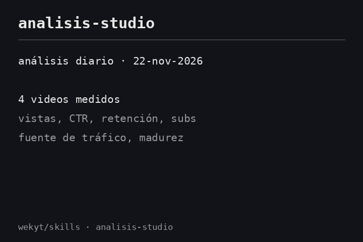

# analisis-studio

**En prueba**

Convierte cada video publicado en una lección que mejora el siguiente: mide
vistas, CTR, retención, suscriptores y fuente de tráfico por video, guarda
cada medición en SQLite (una fila por video y día, sin borrar historial) y
escribe cada día qué funcionó y qué ajustar. Nació para Píldora Tech, donde
corre a diario desde el 24-oct-2026.

## Demo

GIF de 5 s con datos reales de `studio.db`, medición del 22-nov-2026:
barras de vistas de los 4 videos medidos ese día y las dos decisiones que
salieron del análisis (repetir la fórmula de GTA VI, pasar Gemini Mac a
privado). Los números son los de la base, sin redondear ni inventar.

## Verlo en video

Short en producción. La skill no produce videos: analiza los publicados, así
que no tiene un Short propio que la use. Su prueba son las decisiones
registradas con sus datos (ver Antes / después) y la base con 149
mediciones de 61 videos al 22-nov-2026.

Los videos analizados ese día (no son de la skill, son el objeto del
análisis):

- GTA VI, "GTA VI: $3.790 M en un día, récord del entretenimiento":
  https://youtube.com/shorts/C59vRbUuqUY
- Markdown, "Markdown se muere: el jefe de Claude Code pide HTML":
  https://youtube.com/shorts/EndtdsD7tII
- Gemini Mac, "Gemini ya maneja tu Mac por vos: solo en EE. UU.":
  https://youtube.com/shorts/95U-eTavgzg

## Antes / después

**Análisis del 22-nov-2026 (4 videos medidos).**

Antes: cada video se publicaba y la intuición decidía el siguiente tema.
Después: una fila por video y día en `studio.db`, con madurez marcada
(temprana antes de 48-72 h, madura después) y decisiones escritas.

- GTA VI: 1.026 vistas en 8,5 h, CTR 7,5%, retención 62,4%, +3
  suscriptores, 95% del tráfico desde el feed de Shorts. Decisión: repetir
  la fórmula (cifra verificada + marca grande + identidad visual real del
  juego + ángulo LatAm) en los AM siguientes y re-medir a las 32 h.
- Markdown: 442 vistas, CTR 5,2%, retención 75,0% (madura, ~80 h), +2
  suscriptores. Decisión: su video relacionado pasó a apuntar a GTA VI.
- Gemini Mac: 63 vistas en 32 h, CTR 3,1%, retención 45,6%, +1 suscriptor.
  Decisión: el gancho de exclusión geográfica ("solo en EE. UU.") no
  funciona y se descarta como tipo de gancho; el video pasó a privado.
- Vidrio (largo piloto): 5 vistas en 76 h, CTR 2,4%. Decisión: no despega;
  la medición a 7 días decide si se vuelve serie semanal.

Semana 16-22 nov (reporte semanal con estos datos): 63 suscriptores (+12),
~2.600 vistas, 16,1 h de visualización. GTA VI hizo el 40% de las vistas
de la semana en un día.

**Lo que la skill no hace:** no toca nada en Studio (no borra, no cambia
títulos, no republica). No compara videos de edades distintas ni Shorts con
largos. Sin dato, es opinión y se marca como tal.

## Instalación

Copia esta carpeta a `~/.claude/skills/analisis-studio` o al directorio de
skills de tu proyecto. Necesita acceso a YouTube Studio (navegador con la
sesión iniciada) y SQLite. Adapta las rutas `<tu-workspace>` de `SKILL.md`
a tu carpeta de trabajo. El comando `wekyt skill add` llegará después; por
ahora la instalación es copiando la carpeta.

## Estructura

- `SKILL.md`: la skill completa.
- `demo.gif`: la demo en bucle (5 s, datos reales de `studio.db`).

## Licencia

MIT (ver `LICENSE`). Versión `1.0.0` (ver `VERSION`).

---

# analisis-studio

**In testing**

Turns every published video into a lesson for the next one: measures views,
CTR, retention, subscribers and traffic source per video, stores each
measurement in SQLite (one row per video per day, history never deleted) and
writes daily what worked and what to adjust. Built for Píldora Tech, running
daily since Oct 24, 2026.

The 5 s demo GIF above uses real data from `studio.db`, Nov 22, 2026
measurement: view bars for the 4 videos measured that day and the two
decisions that came out of it (repeat the GTA VI formula, set Gemini Mac to
private). No Píldora Tech Short has been produced with this skill: it
analyzes published videos instead of producing them. Its proof is the
recorded decisions with their data and a database of 149 measurements across
61 videos as of Nov 22, 2026.

Install: copy this folder to `~/.claude/skills/analisis-studio` or your
project's skills directory. Requires YouTube Studio access (browser with an
active session) and SQLite. MIT license, version `1.0.0`.
