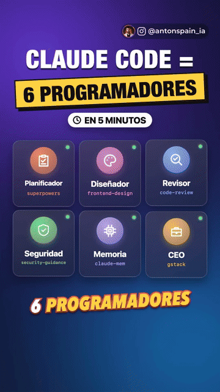

# desarma-video

**En prueba**

Desarma un video de referencia para hacer uno original en el mismo formato:
mide cortes, ritmo y audio con ffmpeg, extrae cuadros y línea de tiempo por
plano, transcribe la voz con faster-whisper local y produce lista de planos,
texto en pantalla, guion, plan de remake y los prompts para recrearlo.

## Demo

GIF en generación desde la tira de cuadros del desarme de Anton (59 cuadros a
1 fps, 58,66 s de video). Muestra la skill trabajando: del video de referencia
a la tira de tiempo que se revisa cuadro a cuadro. Cuando el GIF esté listo,
este archivo lo muestra en bucle.

## Verlo en video

Short en producción. Todavía no hay un Short de Píldora Tech producido desde
un desarme. Los dos remakes propuestos desde los desarmes de esta noche son el
de Anton (teaser del Ep. 8, lun 30-nov, o Short PM en la semana del 1-dic) y el
de la IA que rompe GitHub (Short PM en la semana del 1-dic, con el ángulo de
subagentes).

Los videos que se desarmaron (referencias, no son nuestros):

- Anton, "6 plugins de Claude Code: tu equipo de programadores en 5 minutos":
  https://youtube.com/shorts/Q6y3h1OXBIs
- NoticiasDeIA, "LA IA QUE ROMPE GITHUB":
  https://youtube.com/shorts/iYXJnTCCk_Y

## Antes / después

**Desarme 1, Anton (22-nov-2026).**

Entrada: Short de 58,66 s, 1080x1920, 5.232 vistas, 341 likes, 59 comentarios
(medido el 22-nov). Salida: tira de 59 cuadros, 2 hojas de contacto,
transcripción completa, estructura en 7 secciones (hook de 5,3 s y un plugin
cada 7-9 s), veredicto "todo sintético, cero footage real" con evidencia por
cuadro, 3 de 4 cifras verificadas en vivo en la API de GitHub (superpowers
324.236 estrellas, claude-mem 119.106, gstack 142.392) y plan de remake con
sistema robado (rejilla de 6 tarjetas en el frame 0, figura, comando y
resultado por plugin) y diferencias propias (terminal real grabada, voseo,
paleta Claude).

**Desarme 2, NoticiasDeIA (22-nov-2026).**

Entrada: Short de 54,66 s, 1080x1920, 2.565 vistas, 87 likes. Salida: tira de
55 cuadros, 2 hojas de contacto, transcripción completa, estructura en 6
secciones, veredicto "todo sintético" y el sistema del canal: un mundo único
pixel-art con solo 6 cortes en 55 s, tres zonas fijas (titular arriba, prueba
en el centro, captions abajo). El plan de remake propone el mundo persistente
como formato de noticia y la historia ("la IA rompe GitHub") como Short PM en
la semana del 1-dic, con las cifras pendientes de verificar en la página real.

**Lo que la skill no hace:** no republica el video, no reutiliza su audio ni
pega sus cuadros en el video nuevo. El desarme es solo referencia para un
remake original.

## Instalación

Copia esta carpeta a `~/.claude/skills/desarma-video` o al directorio de
skills de tu proyecto. Necesita `ffmpeg` y `ffprobe` en el PATH y
`python3 -m yt_dlp` para descargar videos de YouTube. Para transcribir,
faster-whisper en local (modelo `small`). El comando `wekyt skill add`
llegará después; por ahora la instalación es copiando la carpeta.

## Estructura

- `SKILL.md`: la skill completa.
- `demo.gif`: la demo en bucle (en generación).

## Licencia

MIT (ver `LICENSE`). Versión `1.0.0` (ver `VERSION`).

---

# desarma-video

**In testing**

Takes a reference video apart to make an original one in the same format:
measures cuts, pace and audio with ffmpeg, extracts frames and a shot-by-shot
timeline, transcribes the voice with local faster-whisper, and produces a shot
list, on-screen text, script, remake plan and prompts to recreate it.

Demo GIF above is being generated from the frame strip of the Anton teardown
(59 frames at 1 fps). No Píldora Tech Short has been produced from a teardown
yet, so there is no "Probado en Píldora Tech" badge and the demo Short is
still in production. Two real teardowns were completed on Nov 22, 2026
(Anton, 5,232 views; NoticiasDeIA, 2,565 views), both with a full remake plan.

Install: copy this folder to `~/.claude/skills/desarma-video` or your
project's skills directory. Requires ffmpeg, ffprobe and yt-dlp; local
faster-whisper for transcription. MIT license, version `1.0.0`.
