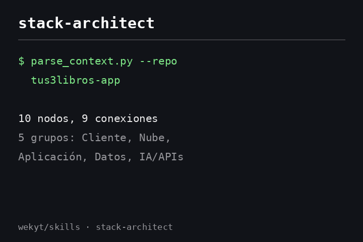

# stack-architect

**En prueba**

Diagramas de arquitectura de software con logos oficiales: lee un repo, una
frase o un PRD, deduce el stack y emite un HTML autocontenido (claro y
oscuro) con logos vectoriales oficiales, aristas ortogonales y validación de
cada SVG antes de cachearlo.

## Demo



GIF de 5 s con las salidas reales de la corrida del 23-nov-2026 sobre el repo
tus3libros-app: parse del repo, revisión del JSON, descarga validada de
logos y render del HTML. El GIF muestra el pipeline, no una captura del
diagrama: la verificación visual del PNG se hace en el navegador, sobre el
HTML, y en esta VM el chromium directo está bloqueado por política del
entorno. El diagrama de esa corrida es `diagrama-tus3libros.html`
(13.658 bytes, 7 nodos, 6 flechas).

## Verlo en video

Short en producción. La skill no ha producido todavía un Short de Píldora
Tech. Su prueba es la verificación end-to-end en repos reales (parluu el
2-nov-2026, tus3libros-app el 23-nov-2026).

## Antes / después

**Corrida real, repo tus3libros-app (23-nov-2026).**

Entrada: repo Next.js 14 real (`tus3libros-app`). Salida del parse:
10 nodos, 9 conexiones, 5 grupos (Cliente, Nube, Aplicación, Datos, IA/APIs).
Revisión del JSON (la skill la exige antes de renderizar): se quitaron 3
nodos que el parser sobre-infirió (AWS, huérfano sin aristas; React y
TypeScript, build-time dentro de Next.js, no servicios) y se agregó la
arista que faltaba (Next.js a Google Books, API de catálogo real). Resultado:
7 nodos, 6 flechas. Logos: 7 marcas resueltas (anthropic, cloudflare,
google, nextdotjs, supabase, vercel desde la caché semilla; googlebooks
resolvió al logo de Google, que no tiene logo propio en las fuentes;
lucide:globe como genérico), cada SVG validado por `validar_svg.py` antes de
cachearse. Render: un solo HTML autocontenido de 13.658 bytes, layout
ortogonal (aristas solo horizontal/vertical, codos a 90°).

**Verificación previa, repo parluu (2-nov-2026).** Corrida end-to-end
completa (parse, logos, render, PNG claro y oscuro) sobre el repo real de
parluu. Sin cifras de antes/después que publicar: el valor es el diagrama
mismo, que antes se hacía a mano.

**Lo que la skill no hace:** no recolorea ni altera los logos oficiales;
si un brand no está en ninguna fuente, usa un genérico `lucide:` y avisa
cuál fue el fallback. Los logos son marcas de sus dueños y se usan solo en
diagramas descriptivos, no como aval.

## Instalación

Copia esta carpeta a `~/.claude/skills/stack-architect` o al directorio de
skills de tu proyecto. Necesita Python 3.10+:

```bash
cd stack-architect
python3 -m venv .venv && source .venv/bin/activate
pip install -r requirements.txt
```

La caché semilla `assets/cache/logos/` trae 9 logos ya validados
(anthropic, cloudflare, google, nextdotjs, resend, supabase, vercel y un
genérico lucide:globe, con su `manifest.json` de fuentes). `fetch_logos.py`
la amplía bajo demanda y valida cada SVG antes de guardarlo. El comando
`wekyt skill add` llegará después; por ahora la instalación es copiando la
carpeta.

## Estructura

- `SKILL.md`: la skill completa.
- `scripts/`: `parse_context.py`, `fetch_logos.py`, `buscar_logos.py`,
  `validar_svg.py`, `render_html.py`, `render_png.py`, `layout_engine.py`.
- `assets/cache/logos/`: caché semilla de logos validados + `manifest.json`.
- `demo.gif`: la demo en bucle (5 s, salidas reales del pipeline).
- `requirements.txt`: `requests`, `pyyaml`.

## Licencia

MIT (ver `LICENSE`). Versión `1.0.0` (ver `VERSION`). El render ortogonal
y la cascada de fuentes de logos incorporan ideas de
caru-ini/stack-diagram (MIT, https://github.com/caru-ini/stack-diagram).

---

# stack-architect

**In testing**

Software architecture diagrams with official logos: reads a repo, a sentence
or a PRD, infers the stack, and emits a self-contained HTML file (light and
dark mode) with official vector logos, orthogonal edges, and validation of
every SVG before caching it.

The 5 s demo GIF above shows the real outputs of the Nov 23, 2026 run on the
tus3libros-app repo: repo parsing, JSON review, validated logo fetching, and
HTML rendering. The GIF shows the pipeline, not a screenshot of the diagram:
visual PNG verification happens in the browser, on the HTML, and headless
Chromium is blocked by environment policy on this VM. That run produced a
13,658-byte self-contained HTML file (7 nodes, 6 edges). No Píldora Tech
Short has been produced with this skill yet; its proof is end-to-end runs on
real repos (parluu on Nov 2, 2026, tus3libros-app on Nov 23, 2026).

Install: copy this folder to `~/.claude/skills/stack-architect` or your
project's skills directory. Requires Python 3.10+ (`python3 -m venv .venv`,
`pip install -r requirements.txt`). MIT license, version `1.0.0`.
