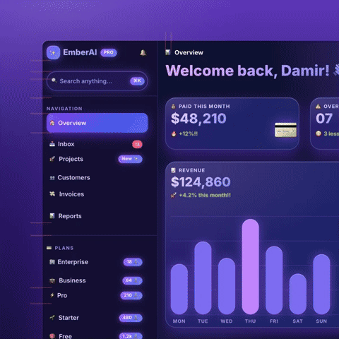

# unslop

**En prueba**

Convierte una UI con aspecto de haber sido generada por IA en una interfaz
diseñada con carácter propio. Encuentra una dirección en el producto mismo y
después arregla el espaciado, el color, los iconos, el copy, la tipografía, el
layout, los detalles, los visuales y el movimiento en ese orden.

## Demo

Demo del autor original (Damir Sokolovsky, CC BY 4.0): los 8 frames del vídeo
de historia de la skill, en orden. El dashboard EmberAI pasa de degradados
violeta, brillos, "Welcome back, Damir!" e insignias con emoji, a una pantalla
oscura y callada con el título "October 2026", una rampa neutra y un acento.
El GIF es un bucle de 4 segundos, 480x480, generado desde el artefacto real
`references/refs/story-dashboard-frames.webp` que trae la skill original.

**Demo propia en Píldora Tech: pendiente.** Falta un antes/después real
nuestro. La auditoría de parluu.com (2-nov) fue solo lectura y no produjo un
rediseño publicado, así que esta skill aún no tiene badge "Probado en Píldora
Tech".

## Verlo en video

Short en producción. Todavía no hay un Short de Píldora Tech donde se haya
usado esta skill.

## Antes / después

**Entrada (demo del autor):** dashboard "EmberAI" con degradado violeta a
azul, barras brillantes, texto con degradado, saludo "Welcome back, Damir! 👋",
insignias `PRO` y `New ✨`, etiquetas en mayúsculas con tracking, espaciado
irregular.

**Salida (demo del autor):** el mismo dashboard con fondo oscuro neutro,
rampa de grises teñida, un acento, espaciado en escala de 4 px, "October 2026"
como título, cifras con formato único y un gráfico con un solo acento. El
vídeo de historia que muestra esta transformación es el vídeo que hizo viral a
la skill, según su autor.

**Uso real en Píldora Tech:** auditoría de parluu.com (2-nov, solo lectura).
Sin rediseño publicado y sin cifras de resultado todavía.

## Qué añade esta versión

- Versión en español de la skill completa (`SKILL.md`).
- Sección 10 nueva: pósters y miniaturas (una palabra héroe, fondo
  cinematográfico con profundidad, cifra siempre con sustantivo, veracidad,
  zona segura). Detalle en `references/posters.md`.
- Lista rápida de auditoría para una pasada de 5 minutos
  (`references/checklist-auditoria.md`).
- Los archivos de referencia originales (`signs.md`, `tokens.md`,
  `visuals.md`, `refs.md`, `effects.md`) se mantienen en su inglés original.

## Origen

unslop fue creado por Damir Sokolovsky ([@heydamir](https://x.com/heydamir),
https://heydamir.design/unslop), licencia CC BY 4.0. Mantén el crédito en
cualquier copia o adaptación. Versión de esta adaptación: `1.0.0` (ver
`VERSION`).

## Instalación

Copia esta carpeta a `~/.claude/skills/unslop` o al directorio de skills de tu
proyecto. La skill funciona en React, Tailwind, HTML y CSS, para dashboards,
apps y landing pages. El comando `wekyt skill add` llegará después; por ahora
la instalación es copiando la carpeta.

## Estructura

- `SKILL.md`: la skill completa en español.
- `demo.gif`: la demo en bucle (4 s).
- `references/`: signos, tokens, visuales, ejemplos, efectos, pósters y lista
  rápida de auditoría.
- `scripts/`: `snapshot.mjs` (guarda una página en vivo) y `story.mjs` (dibuja
  el vídeo de historia).
- `agents/`: configuración del agente OpenAI del original.

## Licencia

CC BY 4.0 (ver `LICENSE`). Atribución: "unslop por Damir Sokolovsky
(@heydamir), CC BY 4.0".

---

# unslop

**In testing**

Turns vibecoded, AI-looking UI into a designed interface with its own
character. Finds a direction from the product itself, then fixes spacing,
color, icons, copy, type, layout, details, visuals and motion in that order.

Demo above: the original author's story video frames (EmberAI dashboard,
before/after), CC BY 4.0. A Píldora Tech demo of our own is still pending: the
parluu.com audit (Nov 2) was read-only and produced no published redesign, so
there is no "Probado en Píldora Tech" badge yet and no Short yet.

Original by Damir Sokolovsky ([@heydamir](https://x.com/heydamir)), CC BY 4.0.
This wekyt adaptation (version `1.0.0`) adds a full Spanish version, a new
posters and thumbnails section, and a 5-minute quick audit checklist.

Install: copy this folder to `~/.claude/skills/unslop` or your project's
skills directory.
